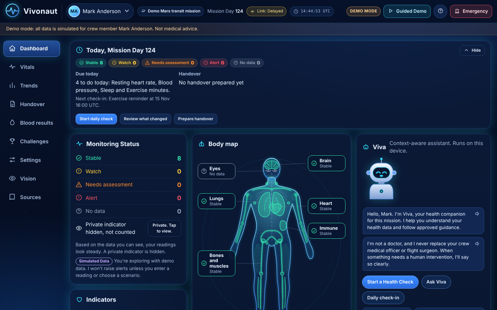
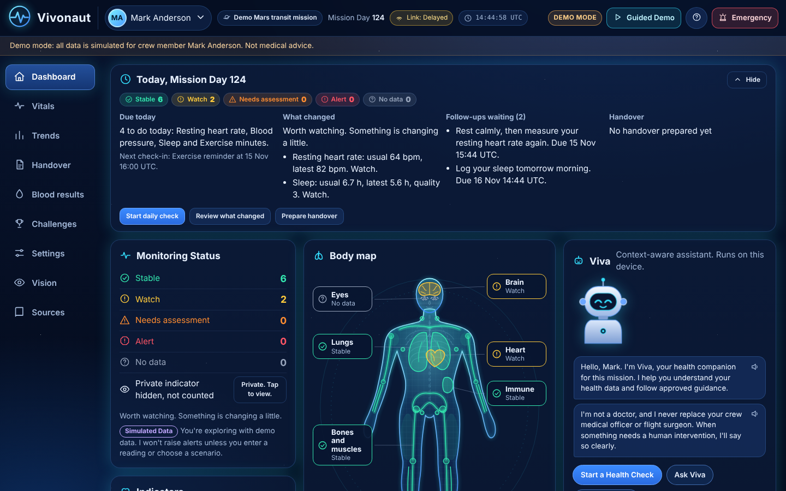
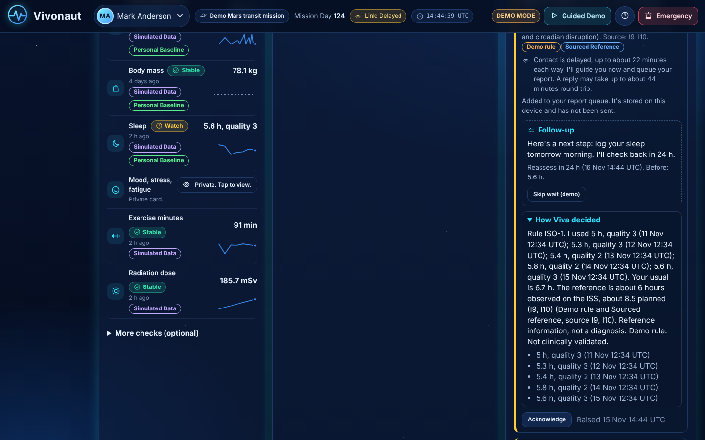
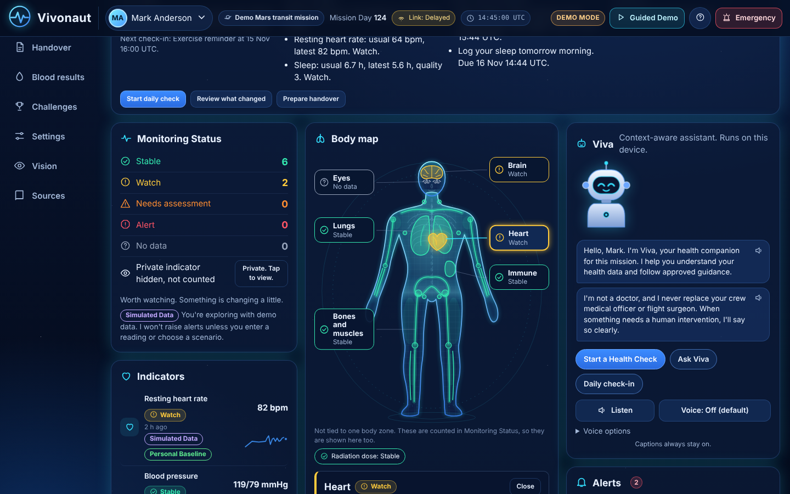
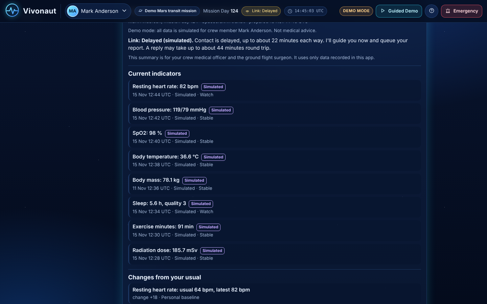
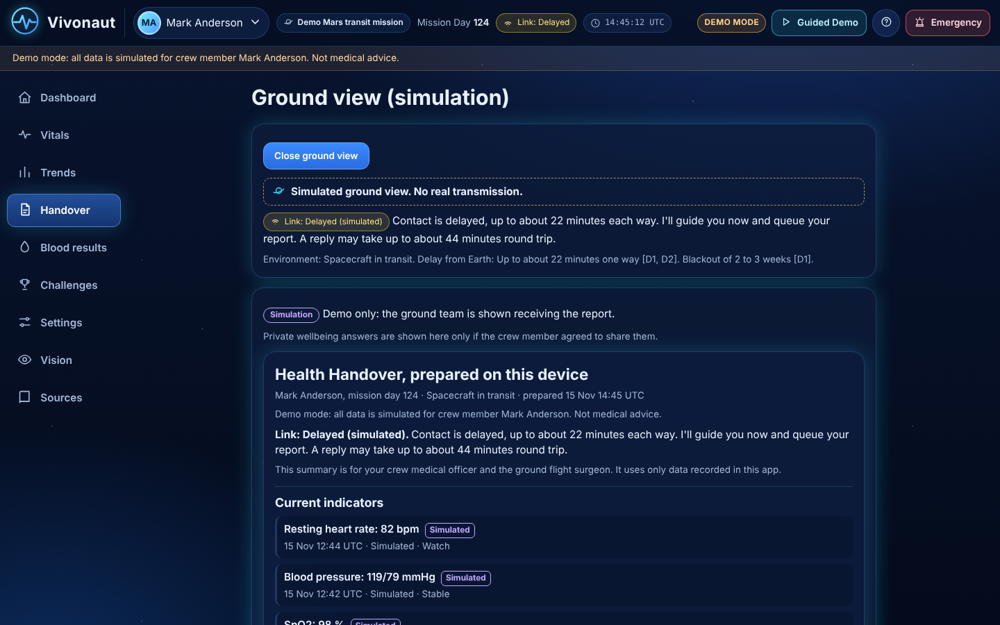
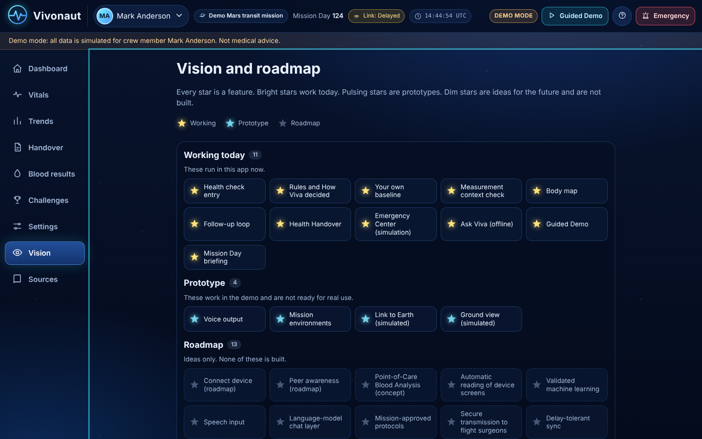
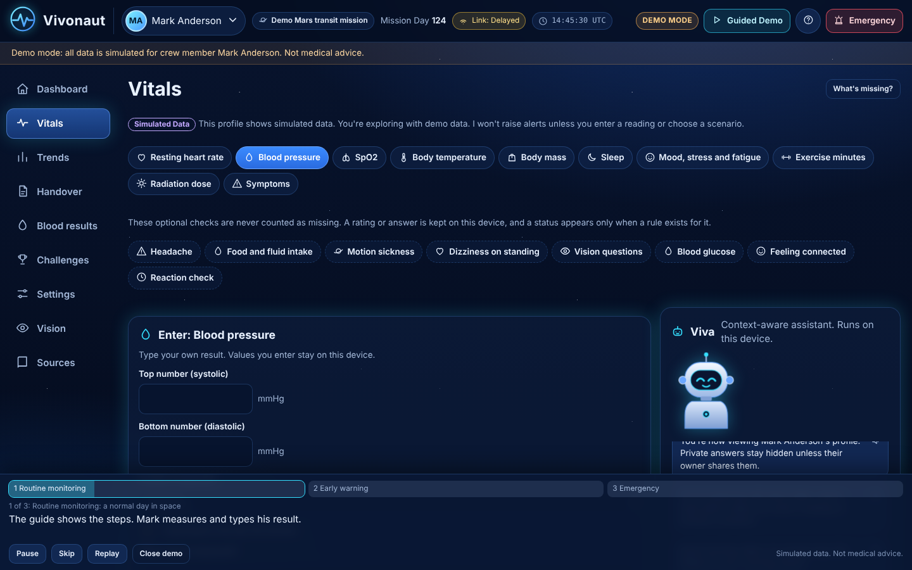
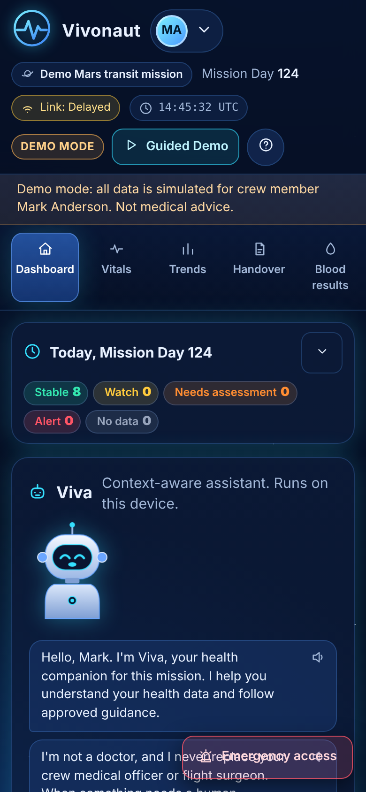

# Vivonaut: your intelligent health companion in space

Vivonaut is an educational prototype of an astronaut health companion, built by Team Vivonaut for the NASA Space Apps Challenge 2026. It helps a crew member on a long mission collect health measurements, check them, compare them with their own usual values, understand what changed, follow up, and prepare a clear summary for the ground team. It supports crew autonomy when contact with Earth is delayed or lost.

It is **not a medical device**. Viva, the companion, never diagnoses and never replaces the crew medical officer, a flight surgeon or approved mission medical procedures. It is not made, endorsed or reviewed by NASA.

**Live demo:** https://nhk25nhk-dotcom.github.io/Vivonaut/
**Project demo (slides):** https://drive.google.com/file/d/186Z0H8lL1_MLFrVSJZXvJUUbqwI_r6i6/view?usp=drive_link

## How to open it

1. Open the live demo link above in any modern browser, or download `index.html` (one single file) and double-click it.
2. It works offline once opened. There is no server, no install, no account, no CDN and no network request while it runs.

The app opens straight on the Dashboard. Viva greets you in her panel. A **Guided Demo** button in the top bar plays three short scenarios. Nothing is spoken unless you turn voice on.

### Try it in three minutes

1. Press **Guided Demo** in the top bar and choose "No, captions only". Three short scenarios play with captions (about two minutes).
2. Press **Start a Health Check** in Viva's panel, or open **Vitals** and enter a reading. Viva checks how it was measured before she interprets it.
3. In **Settings**, choose the **Drift** scenario. A Watch status appears with **How Viva decided**: the rule, the values, the reference and its source.
4. Open **Handover**, press **Generate Health Handover**, then **Ground view (simulation)** to see the report as a ground team would, with a simulated delay.
5. Open **Ask Viva** and try: "Why is my status Watch?", "What is my baseline?", "Is this a diagnosis?", "What works without internet?".

## How it answers the challenge

| NASA hazard | What Vivonaut does (built and tested) |
|---|---|
| Space radiation | A clearly labelled simulated dose and solar event, with rules and explanations. A dosimeter feed is not built. |
| Isolation and confinement | Private mood, stress, fatigue and connection check-ins, a recovery-strain pattern rule, and behavioural emergency lines. |
| Distance from Earth | Live, Delayed and Blackout link modes, offline Ask Viva, and a Health Handover that is ready and queued, never sent. |
| Gravity fields | Cardiovascular and orthostatic checks, bone and muscle context, a body map, and mission environments (station, transit, Moon, Mars). |
| Hostile closed environment | Mission environment settings and symptom patterns. Cabin CO2 and noise monitoring is not built. |

## What is in it

- Dashboard with four statuses (Stable, Watch, Needs assessment, Alert) plus "No data". There is no health score or index.
- Vitals: heart rate, blood pressure, SpO2, temperature, body mass, sleep, mood, exercise and simulated radiation, with validation, a measurement context check and a help card for each.
- Eight optional extra checks (headache, food and fluid intake, motion sickness, dizziness on standing, vision, a reaction check, feeling connected, optional glucose).
- Rules engine with "How Viva decided" on every alert, follow-up before and after, a body map with a privacy view, trends, mission tasks, weekly streak, goals and a timeline.
- Viva: prepared text with keyword and rule matching on this device. No language model, no API. Ask Viva answers from the readings stored in this browser.
- Mission Day Briefing: a card at the top of the Dashboard that gathers what is due today, what changed, follow-ups and the handover status from data the app already holds.
- Health Handover (ready and queued, never sent), a simulated ground view of that handover (Live, Delayed or Blackout, nothing is transmitted), and a fixed, labelled Emergency Center.
- Blood results: a **simulated** demonstration with fictional data (see below).
- Vision screen (what works, what is a prototype, what is a roadmap idea), and a Sources and About page.

## What is simulated

- The demo crew (fictional), the 124-day demo history, the communication link and delay, the solar event and the radiation dose.
- Blood results: a simulated analyzer with a fictional fixture. Vivonaut analyses no blood and connects to no device.
- The ground view: a simulated screen for the ground team with a simulated delay. Nothing is sent, and the stored handover stays "not sent".
- The Guided Demo runs on a scratch copy of the data and restores everything afterwards.
- Rules are **Demo rules** made by the team unless a number is named with a source. They are not clinical standards. The Sources and About page lists each one in plain language.

## What is not built

Cabin CO2 and noise (ENV-1 to ENV-4), the feeling-connected rule (ISO-3), the crew-conflict rule (ISO-4), a status for headache, voice input, ECG, ultrasound, OCT, bone density, wearables, a live dosimeter feed, point-of-care blood analysis (an idea only) and any real transmission to a ground team. Every button either works or says it is a roadmap idea.

## Limits

- Reference ranges are general Earth-adult values, not validated for spaceflight.
- Entered data stays in this browser (localStorage). If the browser blocks storage the app still runs but keeps nothing.
- Tested automatically in headless Chrome and Node during the build, and checked independently by the Team Owner (console errors 0, requests that leave the file 0). Real phones, Safari, Firefox, real voices and screen readers are implemented but have had little testing by people.
- The voice is the browser's built-in text-to-speech, not a custom AI-generated voice. It sounds different on each device and is off by default. The app never uses a microphone.

## Tools and assets

HTML, CSS and plain JavaScript in one file. No external library. All images and icons are original inline SVG. Fonts are the device's system fonts. No NASA logo or insignia, no photographs, no audio files, nothing involving people under 18. All sources are listed in the app (Sources and About) as links that open only when clicked.

## AI-use disclosure

This project was built with assistance from Claude (Anthropic), an AI assistant. Concept, research direction, design decisions, testing and review by Team Vivonaut.

The reference UI mockup used to guide the design was generated with ChatGPT (OpenAI) and carries a visible "Generated with ChatGPT" watermark wherever it is shown. The app does not copy it. Gemini (Google) was used occasionally for quick questions and idea checks; no application code, text or images were generated with it.

The AI-use log (date, phase, account, what was generated, who reviewed it) is in the app under Sources and About and in [`docs/AI_USE_LOG.md`](docs/AI_USE_LOG.md).

## Team

Team Vivonaut: Khelifa Nour El Houda (Team Owner), Emilia Staffiero, Maria Eleni Pouliou.

## License

Copyright 2026 Team Vivonaut (Khelifa Nour El Houda, Emilia Staffiero, Maria Eleni Pouliou). Vivonaut's own code, text and original graphics are released under the [Apache License 2.0](LICENSE), an open source licence as defined by the Open Source Initiative (the same licence NASA applies by default to Space Apps solutions that do not name one).

The application contains no third-party code, library, font, image, audio or dataset. The sources listed in [`docs/RESOURCES.md`](docs/RESOURCES.md) are cited as references and are not redistributed. The Space Apps participant terms are at https://www.spaceappschallenge.org/legal/.

## Screenshots

All screenshots show simulated data from the final build.

| | |
|---|---|
|  Dashboard on first open, with the Mission Day Briefing. |  The Drift scenario: Watch statuses, follow-ups and the body map agree. |
|  "How Viva decided": rule, values, reference and source. |  A body map zone shows linked indicators, never a diagnosis. |
|  Health Handover, prepared on the device. |  Ground view, simulation only. Nothing is transmitted. |
|  Vision screen: what works, what is a prototype, what is an idea. |  Guided Demo with captions. |
|  Phone layout (390 px wide). | |

## Files

- `index.html`: the app (one self-contained file).
- `README.md`: this file.
- `LICENSE`: Apache License 2.0.
- `docs/RESOURCES.md`: every source, tool and asset, including the AI tools, and the licence statement for the materials used.
- `docs/AI_USE_LOG.md`: the AI-use log, phase by phase.
- `docs/science/SCIENCE_MAP.md`: the scientific references and the rules behind each threshold.
- `docs/project/`: the project brief, the build prompts and the Viva scripts (all the words Viva says).
- `docs/screenshots/`: the screenshots above.
